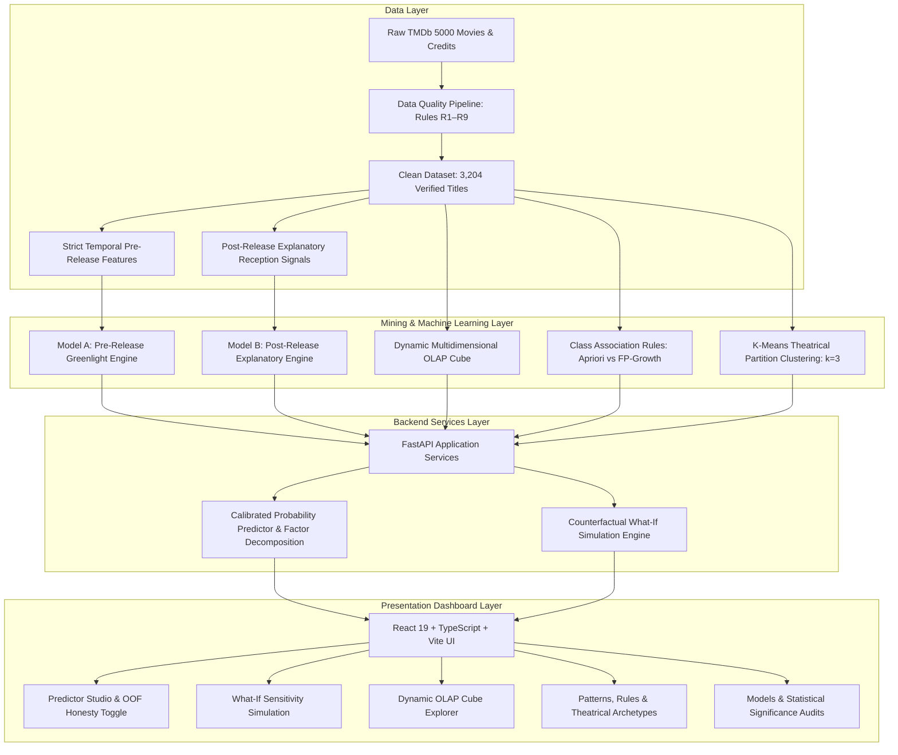

# BoxOffice Oracle: Theatrical Commercial Intelligence & Decision-Support System

[](https://www.python.org/)
[](https://fastapi.tiangolo.com/)
[](https://react.dev/)
[](https://www.typescriptlang.org/)
[](https://vite.dev/)
[](https://tailwindcss.com/)
[](#)

> **VNR Vignana Jyothi Institute of Engineering & Technology (VNRVJIET)**  
> Department of Information Technology — Capstone Project (CBP 2026–27)

---

## 1. Executive Overview & Theatrical Success Metric

**BoxOffice Oracle** is a full-stack, machine learning decision-support system designed to predict whether a feature film will achieve commercial profitability (**Hit** vs **Flop**) prior to theatrical greenlight, operating under strict zero-leakage temporal guarantees.

### Commercial Success Metric: The 2.0x Theatrical Hurdle
In theatrical distribution economics, exhibitors (movie theaters) retain approximately 45% to 55% of all box-office ticket receipts (known in industry accounting as the *theater split*). Consequently, a theatrical release only recoups its production budget when worldwide theatrical gross reaches at least twice its initial production expenditure:

$$\text{ROI} = \frac{\text{Worldwide Box-Office Revenue}}{\text{Production Budget}} \ge 2.0$$

- **Commercial Hit ($\text{ROI} \ge 2.0$):** **1,801 films (56.21%)** in the verified clean dataset ($N = 3,204$)
- **Commercial Flop ($\text{ROI} < 2.0$):** **1,403 films (43.79%)** experiencing theatrical deficit
- **Baseline Classifier (ZeroR / Majority Class):** **56.21% Accuracy**

---

## 2. System Architecture



---

## 3. The Zero-Leakage Protocol & Audit Safeguards

1. **Pre-Release Feature Isolation (Model A):** Strictly excludes post-release revenue, theatrical run length, audience ratings, vote counts, and popularity metrics.
2. **Temporal Star Power Calculation:** Cast and director historical track records (`cast_avg_past_revenue`, `dir_avg_past_revenue`) are computed strictly from titles released **before** the candidate film's release date.
3. **Franchise Retroactivity Safeguard:** TMDb assigns `belongs_to_collection` retroactively to original hits. BoxOffice Oracle enforces that `franchise = 1` only if at least one other film in the collection was released strictly earlier. First instalments (e.g., *Saw 2004*, *The Matrix 1999*, *Iron Man 2008*) are coded as `0`, eliminating outcome leakage.
4. **Honest Out-of-Fold Calibration:** Dataset movies evaluated in the web app display 10-fold cross-validated out-of-fold probabilities (`out_of_fold_probability`) as the headline metric, with optimistic in-sample fit isolated behind a disclosure toggle.

---

## 4. Machine Learning & Algorithmic Benchmarks

### 10-Fold Stratified Cross-Validation Benchmark (ZeroR Baseline: 56.21%)

| Algorithm | Model A Accuracy (Pre-Release) | Model A F1 | Model B Accuracy (+ Reception) | Model B F1 | Nadeau–Bengio Significance vs ZeroR |
| :--- | :---: | :---: | :---: | :---: | :---: |
| **ZeroR (Majority)** | 56.21% | 0.4045 | 56.21% | 0.4045 | Baseline |
| **ID3-style Tree (Entropy)** | 54.74% | 0.5478 | 70.32% | 0.6550 | $p < 0.001$ |
| **CART / C4.5 Tree (Gini)** | 58.55% | 0.5848 | 74.53% | 0.7280 | $p < 0.001$ |
| **Gaussian Naive Bayes** | 56.12% | 0.4165 | 56.27% | 0.4204 | $p = 0.421$ (n.s.) |
| **Categorical Naive Bayes** | 59.83% | 0.6030 | 72.88% | 0.7100 | $p < 0.001$ |
| **K-Nearest Neighbors (KNN)** | 59.61% | 0.5940 | 70.82% | 0.6800 | $p < 0.001$ |
| **Random Forest (Ensemble)** | **61.64%** | **0.6140** | **75.34%** | **0.7520** | $p < 0.001$ |

### Association Rule Mining Benchmark (Apriori vs FP-Growth)
- **High Support Corridor (`min_support = 0.03`):** Apriori is faster (~200 ms vs ~363 ms) due to efficient vectorized bitwise operations on sparse candidate matrices.
- **Low Support / Dense Corridor (`min_support = 0.01`):** FP-Growth is faster (~1,050 ms vs ~1,444 ms) as Apriori suffers from candidate generation explosion ($O(2^k)$ itemset generation).
- **Parity Guarantee:** Both algorithms produce **100% identical frequent itemsets and rule sets** (0 discrepancies).
- *Takeaway:* *"FP-Growth avoids candidate generation and usually wins on larger or denser data / lower support; on this small dataset at high support, Apriori's vectorised implementation was faster."*

### Theatrical Market Archetypes ($k=3$ K-Means)
- **Cluster 0: High-Budget, High-Engagement Blockbusters** (14.3% of market, 83.4% Hit Rate, 3.75x median ROI)
- **Cluster 1: Mid-Budget, Low-Engagement Mainstream Releases** (53.2% of market, 44.3% Hit Rate, 1.75x median ROI — Hollywood's danger zone)
- **Cluster 2: Low-Budget Indie / Sleeper Releases** (32.5% of market, 63.7% Hit Rate, 3.24x median ROI — asymmetric upside)

---

## 5. Local Setup & Execution (Windows PowerShell)

### Prerequisites
- Python 3.10+ (Verified on Python 3.13)
- Node.js 18+ and npm (Verified on Node v24.16.0 / npm 11.13.0)
- Windows 10/11 with PowerShell

### Fresh Clone Setup (One-Click)
To configure the Python virtual environment, install dependencies, clean the dataset, precompute mining artifacts, and train all models:
```powershell
.\scripts\setup.ps1
```

### Starting the Unified Application
To launch the backend API and frontend dev server together:
```powershell
.\scripts\start_all.ps1
```
- **Backend API:** [http://127.0.0.1:8000](http://127.0.0.1:8000) (Interactive Swagger Docs: [http://127.0.0.1:8000/docs](http://127.0.0.1:8000/docs))
- **Frontend Dashboard:** [http://localhost:5173](http://localhost:5173)

---

## 6. How to Retrain Models & Re-mine Artifacts

If you update the dataset or modify hyperparameters, execute individual pipeline stages:
1. **Rebuild Clean Dataset & Features:**
   ```powershell
   .\scripts\build_data.ps1
   ```
2. **Re-mine EDA, OLAP Presets, Association Rules & Clusters:**
   ```powershell
   .\scripts\mine.ps1
   ```
3. **Retrain Supervised Models & Recompute Significance:**
   ```powershell
   .\scripts\train.ps1
   ```
4. **Execute End-to-End Test Suite:**
   ```powershell
   .venv\Scripts\pytest -v
   ```
5. **Run Prediction Latency Benchmark:**
   ```powershell
   .venv\Scripts\python scripts/benchmark_predict.py
   ```

---

## 7. REST API Overview

| Method | Endpoint | Description |
| :--- | :--- | :--- |
| `GET` | `/api/health` | Service health status and loaded artifact verification |
| `POST` | `/api/predict` | Model A / Model B prediction, calibrated probability, and factor decomposition |
| `POST` | `/api/predict/what-if` | Counterfactual sensitivity analysis across varying parameters (12 release months, budget ranges, etc.) |
| `GET` | `/api/insights/eda` | Summary statistics, distributions, and break-even scatter data |
| `POST` | `/api/olap/query` | Multidimensional dynamic OLAP aggregations with rollups, drilldowns, slices, and dices |
| `GET` | `/api/rules` | Class Association Rules with support, confidence, lift, and dual algorithm benchmarks |
| `GET` | `/api/clusters` | K-Means cluster profiles, centroids, elbow SSE, silhouette curves, and Ward linkage data |
| `GET` | `/api/models/metrics` | 10-fold cross-validation metrics ledger across all evaluated models |
| `GET` | `/api/models/significance` | Nadeau–Bengio corrected resampled $t$-test $p$-value and $t$-statistic matrices |
| `GET` | `/api/models/importance` | Permutation feature importance rankings |
| `GET` | `/api/models/tree` | Extracted human-readable decision rules for ID3 and CART trees |
| `GET` | `/api/movies/search` | Auto-complete fuzzy lookup for 3,204 historical films |
| `GET` | `/api/people/search` | Actor and director talent history search |
| `GET` | `/api/meta` | System metadata, genre taxomony, studio list, and budget tier thresholds |

---

## 8. Repository Layout

```
box_office_prediction/
├── backend/
│   ├── app/
│   │   ├── main.py                    # FastAPI application initialization & middleware
│   │   ├── routers/                   # API modular route handlers
│   │   ├── schemas/                   # Pydantic input/output schemas
│   │   └── services/                  # Business logic (Predictor, WhatIf, Search, Loader)
│   └── tests/                         # Pytest test suite (health, API contracts, E2E tests)
├── frontend/
│   ├── src/
│   │   ├── api/client.ts              # Typed Axios API client
│   │   ├── components/                # Reusable UI components (Navbar, Gauge, FactorCard)
│   │   ├── pages/                     # 6 Application pages (Predictor, WhatIf, Insights, Patterns, Models, Method)
│   │   ├── types/api.ts               # Strict TypeScript interfaces matching backend schemas
│   │   └── App.tsx                    # Route definitions and layout
├── ml/
│   ├── build_dataset.py               # Phase 2: Feature pipeline & data builder
│   ├── clean.py                       # Rules R1–R9 cleaning implementation
│   ├── features.py                    # Strict zero-leakage feature engineering
│   ├── eda.py                         # Exploratory data analysis & figure generator
│   ├── olap.py                        # Multidimensional OLAP cube engine
│   ├── rules.py                       # Apriori & FP-Growth CAR mining & benchmarks
│   ├── cluster.py                     # K-Means & Agglomerative Hierarchical clustering
│   └── models.py                      # 10-fold CV, calibration & Nadeau-Bengio tests
├── artifacts/                         # Precomputed serialized models, JSON lookups, and data
├── data/                              # Source TMDb movies and credits CSVs
├── docs/                              # Manual test procedure & architectural reference
├── report/                            # Verification reports, cluster interpretations, and demo cases
├── scripts/
│   ├── start_all.ps1                  # Unified launcher (starts backend + frontend)
│   ├── setup.ps1                      # Complete setup script from fresh clone
│   ├── build_data.ps1                 # Dataset build runner
│   ├── mine.ps1                       # Descriptive mining runner
│   ├── train.ps1                      # Model training runner
│   └── benchmark_predict.py           # /predict latency SLA benchmark (< 300 ms)
├── requirements.txt                   # Verified Python dependencies
└── README.md                          # Master documentation
```

---

## 9. Limitations & Attribution

### System Limitations
1. **Theatrical-Only Accounting:** The system targets theatrical box-office revenue; downstream streaming rights, SVOD licensing, VOD windows, physical media, and merchandising are not captured in the 2.0x break-even target.
2. **Historical Deflator:** Monetary values represent nominal box-office revenues across release years (1916–2016); budget ratios ($\text{Revenue} / \text{Budget}$) inherently normalize for currency inflation.
3. **Marketing Expenditure (P&A):** Print and Advertising budgets are rarely made public by studios; the standard industry heuristic of requiring $2.0\times$ budget to cover both theater split and P&A is applied.

### Data Attribution & Acknowledgements
- **The Movie Database (TMDb):** Movie metadata, credits, release calendars, and cast information provided courtesy of [The Movie Database (TMDb)](https://www.themoviedb.org/). This product uses the TMDb API but is not endorsed or certified by TMDb.
- **Kaggle TMDb 5000 Dataset:** Sourced from the [TMDb 5000 Movie Dataset](https://www.kaggle.com/datasets/tmdb/tmdb-movie-metadata).
- **The Movies Dataset:** Franchise and collection metadata supplemented via [The Movies Dataset](https://www.kaggle.com/datasets/rounakbanik/the-movies-dataset).
