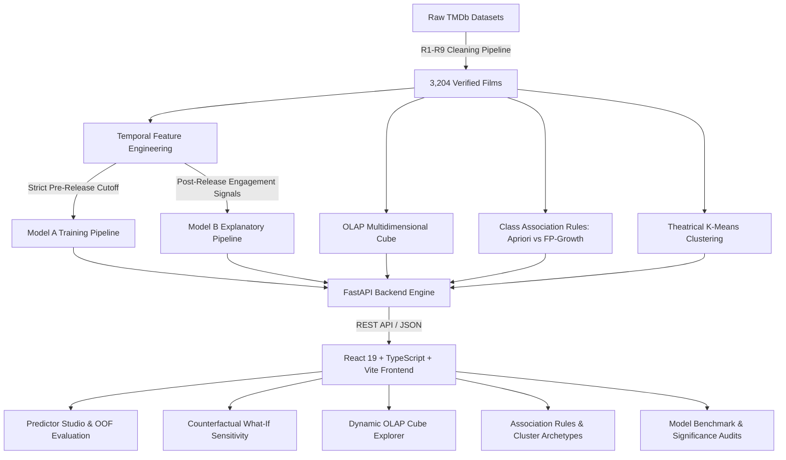

# BoxOffice Oracle: Theatrical Commercial Intelligence & Decision-Support System

[](https://www.python.org/)
[](https://fastapi.tiangolo.com/)
[](https://react.dev/)
[](https://www.typescriptlang.org/)
[](https://vite.dev/)
[](https://tailwindcss.com/)
[](#)

> **VNR Vignana Jyothi Institute of Engineering & Technology (VNRVJIET)**  
> Department of Information Technology — Capstone Project (CBP 2026–27)

---

## Executive Overview

**BoxOffice Oracle** is a full-stack, machine learning decision-support system designed to predict whether a feature film will achieve commercial profitability (**Hit** vs **Flop**) prior to production greenlight, operating under strict zero-leakage temporal guarantees.

### Commercial Success Metric
In film economics, theatrical distributors split ticket grosses roughly 50/50 with exhibitors (theaters). A film only covers its production budget when worldwide theatrical gross reaches twice its initial capital outlay:

$$\text{ROI} = \frac{\text{Worldwide Box-Office Revenue}}{\text{Production Budget}} \ge 2.0$$

- **Hit ($\text{ROI} \ge 2.0$):** 1,799 films (56.15% in verified dataset)
- **Flop ($\text{ROI} < 2.0$):** 1,405 films (43.85% in verified dataset)
- **Baseline ZeroR Classifier:** 56.15%

---

## System Architecture



---

## The Zero-Leakage Protocol

1. **Pre-Release Feature Isolation (Model A):** Strictly excludes post-release revenue, theatrical run metrics, audience ratings, vote counts, and popularity metrics.
2. **Temporal Star Power Calculation:** Cast and director historical track records (past revenue and past hit rates) are computed strictly from titles released **before** the candidate film's scheduled release date.
3. **Franchise Retroactivity Safeguard:** TMDb assigns `belongs_to_collection` retroactively to original hits. BoxOffice Oracle enforces that `franchise = 1` only if at least one other film in the collection was released strictly earlier. First instalments (e.g., *Saw 2004*, *Insidious 2010*, *The Matrix 1999*, *Iron Man 2008*) are coded as `0`, eliminating outcome leakage.
4. **Honest Out-of-Fold Calibration:** Dataset movies evaluated in the web app display 10-fold cross-validated out-of-fold probabilities (`out_of_fold_probability`) as the headline metric, with optimistic in-sample fit isolated behind a disclosure toggle.

---

## Machine Learning Benchmark Summary

All models evaluated under **10-fold Stratified Cross-Validation** with identical paired folds and **Nadeau–Bengio corrected resampled $t$-tests**:

| Algorithm | Model A Accuracy (Pre-Release) | Model A F1 | Model B Accuracy (Post-Release) | Model B F1 | Nadeau–Bengio vs ZeroR |
| :--- | :---: | :---: | :---: | :---: | :---: |
| **ZeroR (Majority)** | 56.15% | 0.404 | 56.15% | 0.404 | Baseline |
| **ID3 (Entropy Tree)** | 57.30% | 0.550 | 70.32% | 0.655 | $p < 0.001$ |
| **CART (Gini Tree)** | 58.74% | 0.591 | 74.53% | 0.728 | $p < 0.001$ |
| **Categorical Naive Bayes** | 59.83% | 0.603 | 72.88% | 0.710 | $p < 0.001$ |
| **K-Nearest Neighbors (KNN)** | 59.61% | 0.594 | 70.82% | 0.680 | $p < 0.001$ |
| **Random Forest Ensemble** | **61.64%** | **0.614** | **75.34%** | **0.752** | $p < 0.001$ |

> **Audit Note:** Model A Random Forest accuracy is 61.64% with zero leakage (corrected from 65.7% after fixing retroactive franchise collection leakage).

---

## Web Application Pages

1. **Commercial Box-Office Predictor (`/`):** Full parameter greenlight studio, "Load a Real Movie" dataset browser, calibrated semi-circle probability gauge, factor explanation cards (*"compared with a typical film (median value)"*), and out-of-fold honesty toggle.
2. **Counterfactual What-If Studio (`/whatif`):** Sensitivity testing varying single parameters (Budget, Release Month, Runtime, Franchise, Studio, Director) with interactive Recharts response curves.
3. **Exploratory Insights & OLAP (`/insights`):** Empirical distributions, break-even scatter plot, and a dynamic multidimensional OLAP cube with 5 canonical presets (**Rollup**, **Drilldown**, **Slice**, **Dice**, **Pivot**).
4. **Patterns & Rules (`/patterns`):** Filterable Class Association Rules (CARs) with support, confidence, lift, Apriori vs FP-Growth runtime benchmark, and K-Means theatrical archetypes ($k=3$).
5. **Model Benchmarks & Audits (`/models`):** 10-fold cross-validation ledger, accuracy bar chart with 56.2% ZeroR baseline reference line, Nadeau–Bengio significance matrices, and feature importance rankings.
6. **Methodology & Integrity (`/method`):** Full academic framing, formula justifications, leakage audit records, and TMDb attribution.

---

## Quickstart & Local Setup

### Prerequisites
- Python 3.10+
- Node.js 18+ and npm
- Windows PowerShell (or bash equivalent)

### 1. Repository Setup & Virtual Environment
```powershell
# Clone the repository
git clone https://github.com/ANT1517/BoxOffice-Oracle.git
cd BoxOffice-Oracle

# Run automatic environment setup
.\scripts\setup.ps1
```

### 2. Build Pipeline (Clean, Mine, Train)
```powershell
# Clean raw TMDb data and apply R1-R9 quality rules
.\scripts\build_data.ps1

# Run descriptive data mining (EDA, OLAP, CARs, K-Means)
.\scripts\mine.ps1

# Train and calibrate production models (Model A & Model B)
.\scripts\train.ps1
```

### 3. Run Application Servers
```powershell
# Terminal 1: Start FastAPI Backend (http://127.0.0.1:8000)
.\scripts\run_backend.ps1

# Terminal 2: Start Vite Frontend (http://localhost:5173)
.\scripts\run_frontend.ps1
```

### 4. Run Test Suite
```powershell
.venv\Scripts\pytest -v backend\tests\test_api.py
```

---

## Attribution & Legal

> *"This product uses the TMDb API but is not endorsed or certified by TMDb."*

All raw film metadata, credits, box-office grosses, and cast profiles originate from The Movie Database (TMDb) via public educational research archives.
